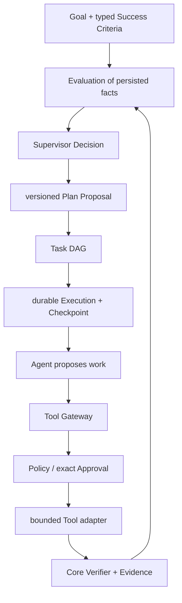
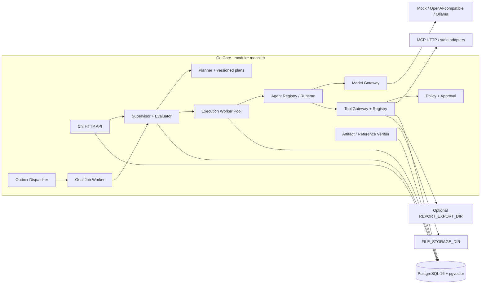

# Personal AI OS

Personal AI OS 是一个以 Goal 为最高管理对象的本地优先 Go 模块化单体。当前仓库实现的是可编译、可测试的 V1 核心垂直切片，不代表设计清单中的所有能力均已交付。本文说明**实际运行的设计与边界**；未实现项请勿视为可用功能。

Personal AI OS is a local-first Go modular monolith with Goals as the top-level management object. This repository contains an executable, tested V1 slice—not every capability in the broader design. This README documents the **current behavior and boundaries**, not future promises.

## 设计目标与不变量 | Goals and invariants

- **Goal-first / 目标优先：** Goal、Task 与执行记录各有独立 UUID 和持久化生命周期；聊天会话不是任务身份。
- **Go Core 控制 / Core owns control:** Go 服务控制领域状态、策略、审批和执行账本。模型及 Agent 只能提供候选计划/结果，不能直接改数据库或授予权限。
- **Evidence-gated completion / 证据门控完成：** Goal 完成请求必须携带可追溯 Evidence。Mock Agent 的结果标记为未验证，不能伪装成任务完成。
- **Policy before side effects / 副作用前先鉴权：** Tool Gateway 使用可信授权解析器和 A0–A3 Policy；审批绑定 Tool 版本、规范化参数哈希和 Execution/Step/Agent 上下文，并一次性消费。文件写入仅在持久化 confirmed Artifact Criterion 的路径下工作；可选 `report.export` 只能复制该 Artifact 到单独配置目录，并要求对 Criterion 版本、路径和 SHA-256 的精确人工审批。
- **Persisted state / 状态持久化：** PostgreSQL 保存 Goal、Task、审批、执行结果、Tool Invocation、Evidence、Outbox、审计、Memory、Knowledge、Node 和模型用量记录。
- **Modular monolith / 模块化单体：** 当前是一个 Go HTTP 程序；领域层依赖本地接口，数据库和 Provider 由适配器实现，避免为 V1 过早拆分服务。

## 设计理念与工程方法 | Design philosophy and method

### 1. Goal 是长期控制对象，不是聊天上下文

Goal 描述要改变的现实状态、成功标准、约束和复核策略；Task 是可以独立排队、重试、取消和恢复的工作单元。Chat/HTTP 请求只是提交命令或读取状态的入口，不能成为 Goal、Task 或 Execution 的身份，也不能决定其生命周期。当前核心关系是：



### 2. Go Core 是控制平面，Agent/Model 是不可信执行适配器

Go Core owns the authority: 它读取并校验 Goal/Task、生成或接受结构化计划、发放 Execution Lease、执行策略、保存审批和决策、验证 Evidence，并决定是否重试、等待、重新规划或完成。Model 负责推理和提出候选 Tool Call；Agent 负责有限任务步骤；Tool Handler 只执行已注册的具体操作。任何一个都不能自行修改 Goal 状态、写可信 Evidence 或提升权限。

实现方法是依赖倒置与 ports/adapters：领域包依赖接口，PostgreSQL、模型供应商、MCP 和原生工具作为适配器注入。模型/provider SDK 的类型限制在 `internal/model` 和 `internal/agent/adapter`，避免业务领域被供应商或 Agent 框架绑定。系统暂不使用 Eino，也不把模块拆成微服务。

### 3. 用“先提议、再授权、后记账”处理工具调用

Tool Registry 的注册只描述版本、Schema、风险、时限和幂等特征，不代表授权。实际调用必须经过统一 Tool Gateway：校验参数 → 验证 Execution Lease/Fencing → 查询可信授权与 A0–A3 Policy → 必要时创建精确绑定参数哈希的 Approval → 持久预留 Invocation → 才调用 Handler → 校验输出并保存结果。批准绑定 Tool identity/version、参数哈希及 Execution/Step/Agent 上下文；参数变化不能沿用旧批准。

副作用按风险进行最小授权：来源读取是低风险；`artifact.write` 只能写入当前 Task 映射的、用户确认的 Artifact Criterion 路径；可选 `report.export` 是独立的 Risk-2 动作，必须由操作者配置单独发布目录，并批准精确的 Criterion 版本、目标路径和 Artifact SHA-256。审批不是 Prompt 中的一句话，而是 PostgreSQL 状态和事务检查。

### 4. 对“恰好一次”保持诚实：持久队列是至少一次，副作用结果可能未知

Goal Job、Execution、Tool Invocation 和 Outbox 都保存于 PostgreSQL。Worker 通过原子 claim、Lease、Heartbeat 和单调递增 Fencing Token 防止两个有效执行者提交同一工作；Checkpoint 与幂等键用于恢复已完成步骤。Outbox 采用 at-least-once 投递并用消费回执去重，事件只提供唤醒信号，消费者重新读取数据库中的权威状态。

Fencing 只防止旧 Worker 提交数据库状态，不能撤销已发生的外部副作用。如果外部请求发出后连接中断、进程崩溃或结果无法持久化，Invocation 进入 `unknown`，不能擅自改判成功或失败，也不能在没有下游幂等保证时盲目重放。此时系统需要下游去重、对账或人工处理。

### 5. Goal 完成是独立验证，不是模型的自我评价

Plan、Agent summary 和自然语言 Evidence 都只是候选信息。完成门禁要求所有必需的 typed Success Criteria 有当前版本的 Core Verifier 记录、对应真实 Execution Evidence，所有 Task 已达终态，并且 Evaluation 与当前 Goal/Task/Execution 事实一致。对于文件标准，Core 会在完成事务中重新读取并核对 Hash；对来源引用，系统核对不可变快照、HTTP 状态、时效、Hash、URL、精确摘录以及报告中的引用标记。

这类检查证明“文件/引用结构与保存的字节一致”，**不**证明来源可靠，也不证明每个语义陈述由来源逻辑支持。因此语义事实核验、来源权威性、报告质量仍需独立审查；系统不会让生成报告的模型替自己签发可信证明。

### 6. 先模块化单体、再依据真实边界拆分

V1 选择一个 Go Core 进程和一个 PostgreSQL 数据库，模块间通过接口隔离。这样可以让 Goal/Task/Policy/Approval/Execution 的关键事务保持本地可验证，同时为将来替换数据库适配器、把 Worker 或 MCP/模型适配器独立部署留出边界。只有在持久化契约、故障语义和权限边界稳定后，才考虑拆服务；不是先为架构图增加服务数量。

### 7. 技术选型服务于一致性和可恢复性

- **Go：** Core、并发 Worker 和适配器使用同一工具链；`context.Context` 将请求取消和超时贯穿模型、Tool、DB 与后台任务。
- **PostgreSQL/pgx：** Goal、Approval、Execution、Outbox、Audit 和 Evidence 需要事务、外键、行锁和 `SKIP LOCKED`；用 JSONB 扩展策略/计划元数据，但身份、状态和关系仍使用关系列。pgvector 扩展/列已预留，Embedding 生成与向量检索尚未接入。
- **Chi：** HTTP 层保持轻量，业务能力不依赖路由框架；请求 ID、超时、认证和错误格式集中在 API 边界。
- **Provider/Gateway adapters：** 模型调用、MCP 和原生 Tool 都通过统一契约接入，注册/发现与授权分离，替换供应商不改变领域状态机。
- **Docker Compose：** 只管理本地基础设施和可选模型进程；Go Core 仍可原生运行、测试和调试，不需要容器化所有模块。

### 系统特点小结 | What makes this system different

- **本地优先但不绑定单一模型：** PostgreSQL 和 Go Core 掌握持久状态；Mock 支持离线开发，OpenAI-compatible 和 Ollama 走相同 Model Gateway。
- **自主能力有明确边界：** “自主”表示系统可按预算持续规划/唤醒工作，不表示模型拥有权限或可以绕过审批。
- **状态可恢复而非只存在于聊天：** Goal Job、Execution、步骤幂等记录、Checkpoint、Outbox 和 Evidence 都有持久化来源。
- **失败语义显式：** 可重试、等待审批、等待外部条件、失败、取消、结果 unknown 是不同状态，系统不通过猜测把它们统一成成功/失败。
- **证据与结论分离：** 数据来源、报告文件 Hash、引用结构和语义真实性是不同验证层；当前只对已实现的确定性检查签发 Evidence。
- **面向本地个人系统的扩展点：** Node、MCP、家庭自动化和机器人未来可以通过适配器接入；当前没有因为预留接口而声称这些设备能力已可用。

## 架构与依赖方向 | Architecture



**控制平面（Go Core）**包括 API、领域 Repository、Supervisor/Evaluator、Planner、Policy、Approval、Goal Job、Outbox、Audit 和 Evidence Verifier；负责决定“做什么、是否有权做、结果能否被接受”。**执行平面**包括有界 Worker、Agent Runtime、Model Gateway、Tool Gateway、MCP/native Tool adapters；只在 Core 授权的 Execution 上运行。外部模型和工具都视为不可信输入/执行边界。

Goal 的规划/执行关系为 `Goal → typed Success Criteria → Evaluation/Decision → versioned Plan → Task DAG → durable Execution/Checkpoint → Tool/Agent → Core Evidence/Verifier`。目前 Subgoal/Milestone 仅由 Goal 父子关系和计划结构预留表达，不存在独立完整的 Subgoal/Milestone 管理 API。MCP Client 支持 operator-configured Streamable HTTP 和 stdio，并将发现的工具注册到现有 Gateway；MCP Tool 默认 A3、非幂等并需要审批。Go Core 由 `make run` 原生运行；Compose 管理 PostgreSQL、测试数据库及可选 Ollama，不默认启动 Go 应用或下载模型。

### 模块职责与当前状态 | Modules and status

| Package | 职责 | 当前状态 |
| --- | --- | --- |
| `internal/api` | Chi 路由、中间件、JSON 输入输出 | 已实现当前列出的 HTTP 路由 |
| `internal/app/config`, `bootstrap`, `database`, `lifecycle` | 配置校验、依赖装配、数据库连接和生命周期 | 环境变量配置、pgx pool、启动/优雅关闭已实现；YAML 是参考模板，不由运行时解析 |
| `internal/goal`, `internal/task` | 领域模型、校验、状态转换、Repository 契约 | 已实现核心状态规则及 PostgreSQL 持久化 |
| `internal/planner` | 结构化计划、JSON 校验、依赖 DAG 校验 | Mock 与 Model Planner 已接入 |
| `internal/supervisor` | 预算内规划/任务调度、Evaluation/Decision、执行账本及恢复协调 | HTTP 和后台 Job 复用有界 turn；持久 Goal Job worker 已接入 |
| `internal/execution` | Execution Run、Step、Lease、Heartbeat、Checkpoint、重试/恢复 | PostgreSQL 持久 Worker Pool；不确定的非幂等结果保留 `unknown` |
| `internal/policy`, `internal/approval` | A0–A3 Policy 决策、参数哈希绑定和一次性人工授权 | Policy 与 Approval 状态持久化；审批不是 Prompt 控制 |
| `internal/tool/gateway`, `registry`, `policy` | 统一工具入口、版本化 Schema 和执行授权 | 可信授权→Gateway→持久 Invocation；所有 Tool dispatch 校验执行租约；不确定结果进入 `unknown` |
| `internal/tool/registry`, `internal/tool/builtin`, `internal/tool/mcp` | 版本化 Tool Registry、原生工具与官方 MCP Client | Native source capture、criterion-scoped Artifact writer、引用绑定和可选审批 Report Export 均走统一 Gateway；MCP Server 定义/Schema 不可信且默认 A3 |
| `internal/agent/runtime`, `registry`, `adapter` | 框架无关 Agent 接口和注册信息 | Mock Agent 保持未验证；非 Mock Provider 使用受限 ModelAgent，通过 Core ToolCaller 执行结构化 Tool Call；无 Eino Adapter |
| `internal/model/gateway`, `provider`, `routing` | 供应商无关 Model Request/Response、调用适配和模型路由边界 | Mock、OpenAI-compatible、Ollama；支持 assistant tool_calls 和关联 Tool Result 往返；高级健康路由仍有限 |
| `internal/source`, `internal/verification` | 不可变来源快照、引用关联、Artifact/Reference 独立验证 | Hash/URL/quote/freshness 和文件字节确定性验证；不做语义蕴含判断 |
| `internal/memory` | 带来源/置信度的记忆模型与 API | PostgreSQL CRUD、软删除和全文搜索 |
| `internal/knowledge` | 文档、内容哈希、分块与引用 | 文本导入及 PostgreSQL 全文检索；未生成 Embedding |
| `internal/node` | 节点身份、能力、状态 | 注册/查询 API 与存储；无独立心跳 HTTP 路由/过期 worker |
| `internal/app/store` | PostgreSQL Repository、事务及持久化适配器 | 已实现当前切片的适配器 |
| `internal/event`, `internal/audit` | 事件与审计领域边界 | Outbox Dispatcher 可持久化唤醒 Goal Job；审计查询/保留策略仍未实现 |
| `internal/identity`, `internal/observability` | 扩展边界 | 多用户/RBAC、OpenTelemetry 尚未完整实现；认证当前为共享 API Key |
| `pkg/contracts`, `pkg/errors`, `pkg/types` | 跨包稳定契约、可暴露错误和通用类型边界 | Contracts 只预留稳定复用；领域对象仍在 `internal/` |

领域包位于 `internal/`，不能被外部 Go 模块直接导入。`pkg/contracts/` 预留稳定跨进程契约，不应将内部领域结构直接用作 wire schema。Framework/Provider 特定类型应留在 Adapter 边界，不能渗透到 Goal、Task、Policy 等领域模型。

## 关键请求与执行流程 | Request and execution flow

1. 进程读取环境变量、建立 pgx pool，应用迁移，然后组装 Repository、Model Gateway、Planner、Agent Registry、Supervisor 与 Chi Server。
2. HTTP 请求经 Request ID、请求日志、恢复、超时和 API Key 中间件处理。`/health` 检查进程存活；`/ready` 检查数据库连接。
3. Planner 生成结构化计划。模型输出使用严格 JSON 解码并验证字段、Goal 归属、预算和依赖 DAG；计划中的任务通过一个数据库事务创建。
4. Supervisor 对单次 turn 施加步骤数、模型调用、Token、工具调用、成本、重试和运行时间预算，并优先执行依赖已满足的任务。模型或 Mock Agent 不能绕过 Go Core 状态管理。
5. Durable Worker 使用 Lease/Heartbeat/Fencing 和 Step 幂等执行 Agent。Agent 只获得 Core 注入的结构化 Tool Caller，不会访问 Handler；Tool Gateway 再校验授权、Schema、Approval、租约与持久幂等。
6. Tool Invocation 成功结果与 Audit/Outbox 事务持久化。进程/Lease 在调用结果未知时会标记 `unknown`，不盲目重放；未知外部效果仍需人工核实，系统不承诺任意外部 API exactly-once。

## 系统如何逐层搭建 | How the system is built

该仓库采用“先建立可验证的权威边界，再接入智能适配器”的实施方法，而不是先接 LLM、再试图给聊天结果补控制逻辑：

1. **运行基座：** 环境配置、结构化日志、pgx、迁移执行器、Chi 中间件、健康检查和优雅退出先组成一个可启动的 Go Core。
2. **领域事实：** Goal、Task、Owner、Success Criteria、状态转换、关系约束和事务审计先落到 PostgreSQL；ID、状态和 Evidence 不依赖对话内存。
3. **执行控制：** 引入 Execution/Step、Checkpoint、Lease、Heartbeat、Fencing、幂等键和未知结果语义，再连接 Supervisor。Goal Job 复用同一个有界 Supervisor turn，不建立另一套后台决策逻辑。
4. **智能接入：** 结构化 Planner、Agent Registry 和 Model Gateway 通过接口接入。Mock 用于确认协议和安全门禁，不作为真实性证明；模型输出必须经 Core Schema、预算、授权和 Verifier 检查。
5. **工具与人类控制：** Tool Registry 描述能力，Gateway 统一做 Policy/Lease/Approval/Invocation；MCP、HTTP 读取、Artifact Writer 和可选 Export 都是受限适配器。审批绑定实际动作与参数 Hash。
6. **恢复与证据：** 领域变更写入事务 Outbox；Dispatcher 只发唤醒信号，接收者重读数据库。快照、引用、Artifact 和 Evidence 通过独立验证器可追溯，失败测试覆盖租约接管、重启和 unknown 边界。
7. **部署和测试：** PostgreSQL/pgvector 由 Compose 管理；Go 应用原生运行。单元测试验证领域，PostgreSQL 集成测试验证事务/并发，子进程故障测试验证恢复；真实网络和真实模型测试必须显式启用并单独报告。

这种顺序的核心是把“模型能建议什么”“Core 允许什么”“工具实际做了什么”“哪些结果可证明”分开建模。每层以接口隔离，上层表达意图，下层只在受控契约内执行；新增模块先明确持久化状态与失败语义，再决定是否引入依赖或独立进程。

## PostgreSQL 数据设计 | Persistence

迁移文件按 `0001`–`0016` 顺序嵌入二进制，应用时使用 PostgreSQL advisory lock、事务及迁移内容校验和。迁移只向前演进，不应手工删除版本记录或在生产库上试验。每条迁移的目的、不可变原则和目录见 [docs/MIGRATION_CATALOG.md](docs/MIGRATION_CATALOG.md)。为保持已部署数据库的 SHA-256 校验一致，历史 migration SQL 不在原文件中追加注释；对其结构的双语说明集中维护在该目录文档。

| Migration | 主要对象 |
| --- | --- |
| `0001_core.sql` | `users`（含本地 owner）、`goals`、`tasks`、`task_dependencies` |
| `0002_execution_approval_memory.sql` | `approvals`、`execution_runs`、`execution_evidence`、`event_outbox`、`audit_records`、`memories` |
| `0003_goal_evidence.sql` | `goal_evidence` |
| `0004_knowledge_vectors.sql` | `vector` 扩展、`knowledge_documents`、`knowledge_chunks.embedding`（接口/列已预留，尚未接入 embedding 检索） |
| `0005_task_attempts.sql` | Task 持久化尝试计数 |
| `0006_nodes.sql` | `nodes` |
| `0007_model_usage.sql` | 按 Goal 累计模型调用和 Token 的 `model_usage` 账本 |
| `0008_durable_execution_runtime.sql` | Durable Execution 的 Lease/Fencing、Checkpoint、Run/Step 幂等和状态历史 |
| `0009_tool_fabric.sql` | `tool_invocations` 持久记录及审批 Tool Version/Execution/Step/Agent/一次性消费绑定 |
| `0010_goal_tool_usage.sql` | 扩展 Goal 用量账本，持久化 Core 观察到的 Tool Call 数量用于跨轮预算 |
| `0011_goal_evaluations.sql` | 持久化 Goal Evaluator 快照历史及查询索引 |
| `0012_structured_goal_criteria.sql` | 为 Goal 增加结构化、版本化的 Success Criteria JSONB 和 GIN 索引 |
| `0013_autonomy_records.sql` | Task PlanKey/Criteria mapping、Criterion Verification/Evidence links、Plan Version/Proposal、Supervisor Decision 历史 |
| `0014_goal_jobs.sql` | Goal Job 持久状态、Lease/Fencing/Heartbeat、运行/重试预算 |
| `0015_outbox_dispatch_leases.sql` | Outbox Dispatcher Lease/重试/死信及 Goal Job 幂等唤醒回执 |
| `0016_source_snapshots.sql` | 不可变来源原始/规范化快照及报告引用绑定 |

主键使用 UUID，业务时间使用 `timestamptz`，可扩展字段使用 JSONB。Goal/Task 创建、修改和转换以及审批决策通过事务写入相关审计/Outbox 记录。Knowledge 和 Memory 当前使用 PostgreSQL 全文检索，不是向量检索。

## HTTP API

完整机器可读描述见 [docs/openapi.yaml](docs/openapi.yaml)。除公开的 Health 路由外，当前 `/api/v1` 路由均受共享 API Key 保护：`X-API-Key` 或 `Authorization: Bearer ...`。没有设置 `PAIOS_API_KEY` 时认证关闭，但服务仅允许绑定 loopback；production 必须配置至少 32 字符的 Key。当前 HTTP 请求映射到固定的本地 Owner，尽管数据库保留多用户外键结构，尚不代表实现了用户登录、独立 API Token 或 RBAC。请求体拒绝未知 JSON 字段，大小限制为 1 MiB；错误采用 `{ "error": { "code", "message", "request_id" } }`。

| 方法 | 路径 | 功能 |
| --- | --- | --- |
| GET | `/health`, `/ready` | 存活及数据库就绪探针（无需 Key） |
| POST/GET | `/api/v1/goals` | 创建/列出 Goal |
| GET/PATCH | `/api/v1/goals/{id}` | 读取/修改 Goal |
| POST | `/api/v1/goals/{id}/activate`, `/pause`, `/resume`, `/complete` | Goal 状态操作；完成需当前版本评估满足全部 required typed criteria，最终 Evidence 由评估派生 |
| POST/GET | `/api/v1/goals/{id}/evaluate`, `/evaluations` | 保存/查询基于持久化事实的 Goal Evaluation；不自动完成 Goal |
| GET | `/api/v1/goals/{id}/decisions` | 查询持久化 Supervisor Decision 历史 |
| GET | `/api/v1/goals/{id}/plan`, `/plan/proposals` | 查询当前 Plan Version 和提案历史 |
| POST | `/api/v1/goals/{id}/replan` | 基于当前 Evaluation 生成并持久化 Plan Proposal（不自动提交） |
| POST | `/api/v1/goals/{id}/plan-proposals/{proposalID}/accept`, `/reject` | Core 校验后原子提交或审计拒绝 Plan Proposal |
| POST/GET | `/api/v1/tasks` | 创建/按 Goal 列出 Task；创建时 `criterion_ids` 只能引用该 Goal 已定义的成功标准 |
| GET | `/api/v1/tasks/{id}` | 读取 Task |
| POST | `/api/v1/tasks/{id}/pause`, `/resume`, `/retry`, `/cancel` | Task 状态操作 |
| POST | `/api/v1/planner/generate` | 生成并持久化结构化计划及任务 |
| POST/GET | `/api/v1/supervisor/turn`, `/api/v1/supervisor/status` | 执行有界 Goal turn / 查看本地协调器状态 |
| POST/GET | `/api/v1/approvals` | 创建审批 / 列出待审批记录 |
| GET | `/api/v1/approvals/{id}` | 查询审批 |
| POST | `/api/v1/approvals/{id}/approve`, `/reject` | 决策审批 |
| GET | `/api/v1/agents`, `/api/v1/agents/{id}` | 列出/查看 Agent Profile；实现类型随 MODEL_PROVIDER 配置而定 |
| POST/GET | `/api/v1/goals/{id}/jobs` | 显式创建/唤醒持久 Goal Job，或查看该 Goal 的 Job 历史；HTTP 请求不运行长循环 |
| GET | `/api/v1/goal-jobs/{jobID}` | 查询 Job 状态、租约、运行/重试计数 |
| POST | `/api/v1/goal-jobs/{jobID}/pause`, `/resume`, `/cancel` | 控制后台 Goal Job 生命周期；暂停/取消会 fencing 当前 Worker |
| GET | `/api/v1/executions/{id}` | 查询持久化 Execution 状态和恢复结果 |
| POST | `/api/v1/executions/{id}/cancel` | 请求取消 Execution；结果可能不确定时会保留 unknown |
| GET | `/api/v1/tools` | 列出已注册 Tool 元数据及健康/启用状态；不返回 Handler，也不授予权限 |
| GET | `/api/v1/tools/{provider}/{tool}/{version}` | 查看精确 Tool 版本和 Schema |
| GET | `/api/v1/mcp/servers` | 查询 MCP Server 连接、版本及发现状态，不返回凭据 |
| POST | `/api/v1/mcp/servers/{id}/enable`, `/disable`, `/reconnect` | 控制已配置 MCP Server 生命周期 |
| DELETE | `/api/v1/mcp/servers/{id}` | 注销当前运行实例并禁用其 Tool |
| POST/GET | `/api/v1/memories` | 创建/列出记忆 |
| GET/PATCH/DELETE | `/api/v1/memories/{id}` | 读取/修改/软删除记忆 |
| POST | `/api/v1/memories/search` | 关键词全文搜索 |
| POST/GET | `/api/v1/knowledge/documents` | 导入文本/列出文档 |
| POST | `/api/v1/knowledge/search` | 全文检索并返回引用 |
| GET | `/api/v1/goals/{id}/sources`, `/api/v1/goals/{id}/sources/{sourceID}` | 查询来源快照及规范化文本 |
| POST/GET | `/api/v1/goals/{id}/source-references` | 绑定/查询报告引用；Core 校验 URL、快照和精确摘录，语义支持仍需独立审阅 |
| GET | `/api/v1/nodes`, `/api/v1/nodes/{id}` | 列出/读取节点 |
| POST | `/api/v1/nodes/register` | 注册节点 |

当前没有 Task PATCH、用户侧 Tool Invocation API、Node 心跳 API、OpenAPI UI 或完整 Subgoal/Milestone CRUD。工具仅通过 Durable Agent Runtime 注入的 Gateway 调用，不提供绕过 Worker/Lease 的 HTTP dispatch 路由。

## 配置与安全 | Configuration and security

运行时**读取环境变量**；`configs/config.example.yaml` 仅作参考模板，当前不由程序解析。`.env.example` 也只是模板。`DATA_DIR` 和 `FILE_STORAGE_DIR` 当前被读取为配置值；`MCP_SERVERS_JSON` 只接受运维配置，不接收 Agent/API 提供的启动命令。

| 环境变量 | 默认值/用途 |
| --- | --- |
| `APP_ENV`, `APP_HOST`, `APP_PORT` | `development`, `127.0.0.1`, `8080` |
| `DATABASE_URL` | PostgreSQL 连接串；必须提供 |
| `LOG_LEVEL` | `info`；JSON 结构化日志 |
| `PAIOS_API_KEY` | 空表示关闭认证；生产环境必填且至少 32 字符 |
| `MODEL_PROVIDER` | `mock`；另支持 `openai-compatible`、`ollama` |
| `MODEL_BASE_URL`, `MODEL_API_KEY`, `MODEL_NAME` | OpenAI-compatible Provider 配置；Secret 只从环境变量读取 |
| `OLLAMA_BASE_URL` | `http://localhost:11434` |
| `DATA_DIR`, `FILE_STORAGE_DIR` | `DATA_DIR` 预留；`FILE_STORAGE_DIR` 为 Native file Tools、criterion-scoped `artifact.write` 和 Core ArtifactVerifier 的可信根 |
| `HTTP_FETCH_ALLOWED_HOSTS` | 逗号分隔的精确主机白名单；未配置时不注册 `http.fetch`/`source.capture`。快照采集仅 HTTP(S)，每跳重新校验白名单，DNS 解析后仅直连公有地址，最多 5 次重定向、15 秒整体超时、2 MiB 响应上限，并校验 MIME |
| `REPORT_EXPORT_DIR` | 可选的独立导出根目录；仅当它与 `FILE_STORAGE_DIR` 分离时注册 `report.export`，此工具仅复制哈希与审批参数一致的 Criterion Artifact |
| `PAIOS_LIVE_SOURCE_URL`, `PAIOS_LIVE_SOURCE_ALLOWED_HOSTS` | 可选 live-source acceptance；必须显式提供 HTTPS URL 和精确公开主机白名单，启用命令见 `make test-source-live` |
| `MCP_SERVERS_JSON` | 操作员提供的严格 JSON Server 配置数组；留空时不启动 MCP Server。HTTP 需 HTTPS/精确 host allowlist；stdio 需绝对命令、独立 argv、工作目录和显式环境 |
| `MAX_AGENT_STEPS`, `MAX_MODEL_CALLS`, `MAX_MODEL_TOKENS`, `MAX_TOOL_CALLS` | Supervisor 单次 Goal turn 预算 |
| `MAX_EXECUTION_SECONDS`, `MAX_EXECUTION_COST`, `MAX_RETRIES` | 执行时间、成本和重试预算 |
| `POSTGRES_PASSWORD` | Compose 数据库密码；请修改默认值 |
| `PAIOS_DATA_DIR`, `OLLAMA_DATA_DIR` | Compose 主机持久化路径 |

不要提交真实 Key、密码、用户数据或 `.env`。Compose 将 PostgreSQL/Ollama 端口绑定到 loopback；数据库默认数据目录为仓库 `data/postgres`，可在 `.env` 中改为外置 SSD 绝对路径。Ollama 需用 Compose 的 `ollama` profile 显式启动；不会自动下载模型。对外暴露 API 前应配置 TLS/反向代理和强 API Key，并限制网络访问。

## 本地运行 | Local development

### 系统搭建思路 | Build and deployment workflow

当前部署刻意保持“一个 Core 进程 + 一个 PostgreSQL”：Compose 只负责 PostgreSQL/pgvector（以及 profile 启用时的测试 DB 或 Ollama），Go Core 由 `make run` 原生启动。该方式让本地调试、信号/子进程测试和 Apple Silicon 开发更直接；未来可把同一有界 Worker 适配器移到单独进程，而不改变 Goal/Task/Policy 的权威边界。

#### 运行前准备

- macOS/Linux 开发环境；Go 1.25 或更新版本。项目 `go.mod` 要求 Go 1.25.0；CI 固定检查该最低工具链。
- Docker Compose v2，用于启动 PostgreSQL 16 + pgvector。Go Core 本身不在 Compose 中。
- 本地默认模型是 `mock`，不需要 API Key。要使用云模型需另外配置 OpenAI-compatible endpoint、模型名和 Secret；这些值从环境变量读取，不能写入代码或提交仓库。
- `FILE_STORAGE_DIR` 由 Core 用于 criterion-scoped 报告产物和 ArtifactVerifier。设置 `REPORT_EXPORT_DIR` 是可选的人工批准发布出口；它必须是单独目录。

#### 首次启动

1. 复制 `.env.example` 为本地 `.env`，改掉 `POSTGRES_PASSWORD`。如需开启 HTTP API 认证，设置至少 32 字符的 `PAIOS_API_KEY`；不设置时服务只允许 loopback 绑定。
2. 选择 PostgreSQL 数据目录。默认落在仓库 `data/postgres`；如需外置 SSD，将 `PAIOS_DATA_DIR` 设为该绝对路径。不要把已有生产/个人数据目录用作集成测试卷。
3. 运行 `make docker-up`。该目标启动 PostgreSQL 服务并等待数据库 healthcheck；首次启动需要拉取 `pgvector/pgvector:pg16` 镜像。
4. 运行 `make migrate` 可单独应用数据库迁移。正常 `make run` 启动时也会检查并应用待执行迁移；迁移按版本排序，在事务/advisory lock 中执行并校验历史文件 Hash。
5. 运行 `make run` 启动 Go Core。访问 `/health` 检查进程存活，`/ready` 检查数据库连接。终止进程使用 SIGINT/SIGTERM 可触发 HTTP/Worker 优雅关闭。

如果只是编译/单测，不必先起数据库：`make build`、`make test`、`make vet`。真实 PostgreSQL 的 `make test-integration` 会创建并清理专属 `paios-integration-test-data` 测试卷；不要把它改指向个人或生产库。`make docker-down` 会关闭当前项目 Compose 服务，日常跑单测或集成测试无需调用它。

#### 可选模型与受控能力

- Mock 模式便于离线开发；Mock Agent 的工作结果默认不可信，因此不能据此完成 Goal。
- Ollama 作为可选 Compose profile：先在 `.env` 设置 `MODEL_PROVIDER=ollama`、明确的 `MODEL_NAME` 和 `OLLAMA_BASE_URL=http://localhost:11434`，然后启动模型服务并另行启动 Go Core：

	```sh
	docker compose --env-file .env --profile ollama -f deployments/compose/docker-compose.yml up -d ollama
	make run
	```

	Compose 不会自动下载大型模型；模型下载应由操作者显式执行，并评估磁盘与内存需求。不要在未配置模型名时切换 Provider。
- `source.capture` 只有在 `HTTP_FETCH_ALLOWED_HOSTS` 配置精确公开主机名后注册。它限制 HTTP(S)、端口、DNS 公网地址、重定向、MIME、响应大小和超时；网页正文始终是非可信数据，不作为指令执行。
- `report.export` 默认不注册。只有显式设置并创建独立的 `REPORT_EXPORT_DIR` 后才启用；它仅复制与 Core 已验证 Hash 一致的报告，并需用户批准同一 Criterion 版本、路径和 Hash 的精确动作。
- `MCP_SERVERS_JSON` 只接受运维配置的 MCP 服务，不接受 Agent/模型生成的命令或凭据。发现的 Tool 仍须逐个经过 Gateway Policy，不因 MCP 注册而自动可信。

#### API 认证和状态推进

配置 `PAIOS_API_KEY` 后，请求使用 `X-API-Key` 或 Bearer Token。当前 API 的业务 owner 映射到一个本地 Owner，**不是**完整的多用户登录/RBAC 系统。Goal 创建后先以 `draft` 保存；用户确认后调用 `/activate`，再调用 `POST /goals/{id}/jobs` 显式创建后台 Job。后续由 Goal Job Worker、Execution Worker 和 Outbox Dispatcher 推进，不需要持续轮询 Supervisor HTTP turn。`waiting_approval` 状态应通过审批接口做决定；Job 由 Outbox 事件唤醒。

服务停止、数据库不可用或 Tool 结果不确定时，应先查看 Goal Job、Execution、Approval、Evidence 和 Audit/Outbox 状态；不要直接改库把 `unknown` 改成成功。终态 Goal 的重新执行必须通过新的业务决策，而不是重放旧副作用。

Make targets：`make build`、`make build-arm64`、`make test`、`make vet`、`make fmt`、`make run`、`make migrate`、`make docker-up`、`make docker-down`、`make db-test-up`、`make db-test-down`、`make db-test-clean`、`make test-integration`、`make test-autonomous-e2e` 和显式外网目标 `make test-source-live`。`test-autonomous-e2e` 使用可控 HTTP fixture，不代表 live source 或 real-model 验收；`test-source-live` 缺 URL/白名单时会以 BLOCKED 拒绝运行。GitHub Actions [Go CI workflow](.github/workflows/ci.yml) pins Go 1.25.0 exactly, asserts the running toolchain, runs race/PostgreSQL acceptance, and separately tests stdio subprocess recovery and darwin/arm64 builds. `make run` 与 `make migrate` 需要 PostgreSQL；`make docker-*` 需要 Docker，并要求先创建 `.env`。Phase 9 的隔离数据库验收结果见 [docs/DATABASE_INTEGRATION_REPORT.md](docs/DATABASE_INTEGRATION_REPORT.md)。

## API 快速示例 | API example

下面示例演示“创建 Goal → 激活 → 显式启动后台 Job → 查询状态”。若 API Key 已配置，先在当前 shell 中设置 `PAIOS_API_KEY`。结构化 `criteria` 是推荐用法；Legacy 自由文本 `success_criteria` 为兼容字段，不能自动验证。

```sh
curl -sS http://localhost:8080/api/v1/goals \
	-H 'Content-Type: application/json' \
	-H "X-API-Key: ${PAIOS_API_KEY}" \
	-d '{
	  "title":"Prepare a phased home automation research report",
	  "description":"Compare the local constraints and document a reviewable implementation plan.",
	  "priority":4,
	  "criteria":[{
	    "id":"report",
	    "name":"Structured report exists",
	    "description":"A Markdown report has the requested sections and can be verified by Core.",
	    "type":"markdown_structure",
	    "required":true,
	    "validation_method":"artifact_in_file_storage",
	    "artifact_path":"reports/home-automation.md",
	    "required_sections":["Summary","Phases"],
	    "max_artifact_bytes":1048576
	  }],
	  "constraints":["Do not control devices or publish the report without approval."]
	}'
```

从创建响应中复制 `id`（或 `goal_id`）并设置 `GOAL_ID`，然后激活并启动 Job：

```sh
curl -sS -X POST "http://localhost:8080/api/v1/goals/${GOAL_ID}/activate" \
	-H "X-API-Key: ${PAIOS_API_KEY}"

curl -sS -X POST "http://localhost:8080/api/v1/goals/${GOAL_ID}/jobs" \
	-H "X-API-Key: ${PAIOS_API_KEY}"

curl -sS "http://localhost:8080/api/v1/goals/${GOAL_ID}/jobs" \
	-H "X-API-Key: ${PAIOS_API_KEY}"
```

Job 创建 API 只负责持久化/唤醒，不在 HTTP 请求中运行完整 Supervisor 循环。`/supervisor/turn` 可用于显式单步操作/诊断，不是后台 Job 的控制机制。默认 Mock Planner 可生成确定性计划；Mock Agent 的工作结果未经独立验证，**不会**让 Task/Goal 虚假完成，Job 可能进入等待、失败或需要人工复核。报告写入仅在 Agent 通过 Gateway 调用受 Criterion 限定的 `artifact.write` 时进行。

## 测试、验证与已知限制 | Tests and limitations

测试覆盖 Goal/Task 状态转换、Evidence 门控、A0–A3 Policy、审批哈希和过期、Tool Registry/Gateway、Native filesystem/SSRF 边界、模型 Tool Call 往返/Approval Checkpoint 精确续行/输出不写入 checkpoint、预算校验、配置校验、计划 DAG、Provider/Tool-call Schema、Knowledge 分块等。MCP 测试使用官方 SDK Client + 真实 Streamable HTTP Server 和真实 stdio 子进程 Server，覆盖发现、Schema 变更、审批、重放、错误、超时、主动取消、进程崩溃及自动恢复。PostgreSQL 集成测试覆盖 MCP Gateway 审批、Invocation/Audit/Outbox、恢复以及 Goal Tool Call 累计预算账本。

Phase 12.3.1–12.3.3 的历史验收中，`make fmt`、`make test`、`make build`、`make vet`、race、ARM64 build 和真实 PostgreSQL 集成套件曾通过。Phase 12.3.4 新增 criterion-scoped Writer、Approval-bound `report.export` 和 PostgreSQL E2E/unknown-crash 测试后，相关离线单测包通过；当前全仓/数据库验收因 `proxy.golang.org` 下载 pgx/Chi 超时而 BLOCKED，不能把历史基线当作最新改动通过。`make test-source-live` 在未配置 URL/白名单时按预期拒绝运行；没有真实来源被抓取。Hosted CI 的 Go 1.25 结果仍需单独确认。详情见 [docs/TEST_REPORT.md](docs/TEST_REPORT.md)、[docs/AUTONOMOUS_RUNTIME_REPORT.md](docs/AUTONOMOUS_RUNTIME_REPORT.md)、[docs/EVENT_DRIVEN_RUNTIME_REPORT.md](docs/EVENT_DRIVEN_RUNTIME_REPORT.md)、[docs/SOURCE_SNAPSHOT_REPORT.md](docs/SOURCE_SNAPSHOT_REPORT.md) 和 [docs/AUTONOMOUS_GOAL_E2E_REPORT.md](docs/AUTONOMOUS_GOAL_E2E_REPORT.md)。

当前结构化 criteria 支持 verified evidence/task 规则，以及 FILE_STORAGE_DIR 下 artifact existence、Markdown 必需标题和可选 Source Reference 结构校验；验证写入带 Criterion 版本、Evidence UUID、Verifier 版本和 SHA-256。完成门禁复核当前 Artifact Hash，并可核验来源快照完整性、时效、URL 绑定、精确摘录和报告可见引用。它不判断报告语义或来源是否权威，不能将 lexical match 当作真实性证明。ModelAgent 的最终文本仍不可信；只有 Core 注入的确定性 verifier 结果可支持已实现的检查。Goal Job 与事件唤醒现在已持久化；仍缺多 Agent、MCP OAuth/凭据仓库、Memory/Knowledge Embedding 检索、RBAC/API Token、通用外部 Outbox 发布、Audit retention/query、OpenTelemetry 和 Node heartbeat API。Tool 外部副作用状态为 unknown 时不会自动重放，也不承诺任意外部 API exactly-once。

Phase 12.2.3–12.2.5 已有部分可用的持久化基础：Migration 0013 保存 Criterion Verification、Task criterion mapping、Plan Version/Proposal 和 Supervisor Decision；Evaluator 将建议映射到可查询、幂等的 Decision；初始计划通过 Proposal→Core commit 创建；Supervisor 对失败/阻塞或可补充的标准差距生成有界 replanning proposal。提交会检查 DAG、Criteria mapping、任务预算、Plan Base Version，并保留已完成 Task；运行/等待中的 Task 必须继续保留，不支持静默移除；无新增 Task 的 replan 被拒绝。Decision 与 Evidence/Audit/Outbox 可恢复，Goal 锁协调 Task/Evidence 写入与完成门禁。

本阶段仍不是完整的端到端自主执行闭环：受 Criterion 授权的报告 writer 和独立 Artifact/Reference verifier 已实现，且有确定性 Research E2E/unknown Worker-crash 测试代码，但这些新 PostgreSQL 场景尚未因依赖下载超时而验证。语义来源支持没有被判定；真实公开来源未采集；Worker crash/unknown 和研究报告完成仍在不同测试场景中，尚未形成同一 Goal 的完整故障恢复闭环。具体状态见 [docs/AUTONOMOUS_GOAL_E2E_REPORT.md](docs/AUTONOMOUS_GOAL_E2E_REPORT.md)。

更详细的边界与事务说明见 [Verification Design](docs/VERIFICATION_DESIGN.md)、[Dynamic Planning Design](docs/DYNAMIC_PLANNING_DESIGN.md) 和 [Supervisor Design](docs/SUPERVISOR_DESIGN.md)。

## 依赖边界与变更原则 | Contribution boundaries

- 核心领域保持框架无关；Agent 框架、模型供应商 SDK 和 MCP 类型只能位于适配层。
- 模型 Tool Call 是待授权的提议，不是命令；新增副作用工具必须接入 Policy、参数绑定 Approval、审计和持久化执行保护后才可启用。
- 所有外部操作采用 `context.Context`、明确超时及可取消边界；新增数据库对象通过向前迁移维护。
- 测试贴近所属包；跨模块数据库测试放入 `tests/integration/`，E2E 放入 `tests/e2e/`。
- Go 源文件的 Package/模块说明和非显而易见的契约/状态/安全注释采用英文与中文成对书写；测试代码也说明其夹具、故障注入和验收边界。注释解释“为什么/约束”，不重复逐行语法。
- `//go:embed`、build tag 等编译器指令必须保持工具要求的原始格式；其用途通过相邻双语注释说明。
- 已发布/可能已应用的 SQL migration 因启动时校验 SHA-256 而不可直接加注释或重排；每个版本的中英双语用途见 [docs/MIGRATION_CATALOG.md](docs/MIGRATION_CATALOG.md)，新增 Schema 只追加迁移。
- 每次报告功能状态时区分已实现、仅有接口/迁移预留及未实现，不能把未来设计写成现有能力。
